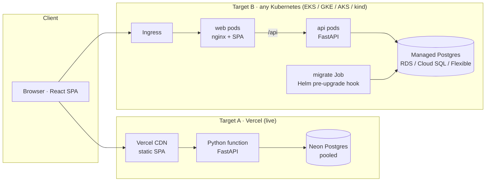

# Sparkboard

**Drop an idea. Fan the best ones. Watch them ship.**
Sparkboard is a community idea board by [Infrenic](https://infrenic.com): people post ideas, vote on them, discuss them, and follow them across a public roadmap from *Open* to *Shipped*.

It is also a reference platform. The same app ships through an AI-assisted delivery pipeline to a serverless target (Vercel + Neon) or any Kubernetes cloud (AWS, GCP, Azure) from one set of modular Terraform, one Helm chart and one set of GitHub Actions workflows.

| | |
|---|---|
| **Live** | **https://ideas.infrenic.com** (Vercel + Neon Postgres) |
| **API docs** | https://ideas.infrenic.com/api/docs |
| **Kubernetes** | Helm chart proven on `kind` (`make kind-up`). EKS / GKE / AKS roots are validated but not applied; see [Deployments](#deployments). |

---

## Contents

1. [The product](#the-product)
2. [Architecture](#architecture)
3. [Run it locally](#run-it-locally)
4. [Quality gates](#quality-gates)
5. [The pipeline: configure and deploy](#the-pipeline-configure-and-deploy)
6. [AI integration](#ai-integration)
7. [Cloud-agnostic approach](#cloud-agnostic-approach)
8. [Deployments](#deployments)
9. [Security](#security)
10. [Trade-offs and next steps](#trade-offs-and-next-steps)

---

## The product

The brief asked for a list of ideas and a form. Sparkboard keeps that contract exactly (`GET /api/ideas`, `POST /api/ideas` with `{"content": "..."}`, an `ideas` table with `id, content, created_at`) and builds a consumer-grade product around it:

- **A landing page that is the product.** Inspired by editorial "problem board" sites: night and paper sections on a drafting grid, huge uppercase grotesk type, one electric cobalt accent. The hero prints the three most-wanted ideas as perforated tickets. Cut-out "sticker" stats are computed live from the board.
- **Top 10 bento.** The most-voted ideas as a ranked grid of white, cobalt and slate tiles, each with a topic pill, rank, votes and a **heat score** (0–100, from votes and discussion).
- **All ideas table.** Search, topic and status filters, and Heat / Rising / Newest sorting, all kept in the URL so every view is shareable. One vote per device is enforced in the database. Votes update optimistically with a spark burst, and confetti fires at 10 / 25 / 50 / 100 votes.
- **Seeded with real problems.** 114 problem statements from Razorpay's [Fix My Itch](https://razorpay.com/m/fix-my-itch/) are imported with attribution (`apps/api/data/fix-my-itch.json`, `python -m sparkboard_api.importers.fix_my_itch`, idempotent). They start at zero votes, so this board's users decide the ranking.
- **Duplicates caught while typing.** The composer shows similar ideas live (Postgres trigram + word similarity), so people vote instead of reposting.
- **AI "Sharpen".** One click suggests a clear headline, a tighter description and tags. You accept or dismiss it. It is hidden when no AI key is configured.
- **Idea sheet.** A shareable `/i/:id` side sheet (a bottom sheet on phones) with discussion and native share.
- **Roadmap.** A four-column board (Open → Planned → Building → Shipped). Status changes are admin-only (`X-Admin-Token`).
- **Keyboard first.** `N` posts an idea, `/` or `⌘K` opens the command palette (search ideas, jump anywhere).
- **No sign-up.** Anonymous identity is a random device token. Only its SHA-256 hash is stored. People pick a display name and a generated avatar the first time they vote or post.
- **Polish.** Staggered reveals, ticket fan-out, a tag marquee, skeletons, designed empty and error states, reduced-motion support, a PWA manifest, an OG card, and a 390 px-first responsive layout.

**Stack.** React 19 + TypeScript (strict) + Vite + Tailwind v4 + Motion + TanStack Query + Radix + cmdk, set in Host Grotesk / Anton / JetBrains Mono. FastAPI + SQLAlchemy 2 (async) + asyncpg + Alembic + Pydantic v2. PostgreSQL 17.

---

## Architecture



```
apps/api/            FastAPI service: routers → services → repositories → models (one layer = one job)
apps/web/            React SPA: features/{feed,composer,vote,idea,roadmap,palette,profile}, ui/, lib/
api/index.py         Vercel entry point (re-exports the FastAPI app)
docker/              api + web Dockerfiles (multi-stage, non-root), nginx template
docker-compose.yml   local stack: db → migrate → api → web (+ optional seed)
deploy/helm/         one chart for every cluster; values-<cloud>.yaml holds the small differences
deploy/kind/         local Kubernetes proof (kind + ingress-nginx)
infra/terraform/     sizing · platform/{aws,gcp,azure} · app · vercel modules + thin live roots
tools/aiops/         the AI delivery toolkit used by the workflows (typed, tested, policy-guarded)
environments/        plain-language environment intents + guardrail policy + generated configs
.github/workflows/   ci · ai-review · chatops · deploy-vercel · deploy-k8s · ai-env-config · codeql
```

More detail, including the request path, data model and deploy sequence diagrams, is in [docs/architecture.md](docs/architecture.md).

---

## Run it locally

**Requirements:** Docker with Compose v2. For the hot-reload dev loop you also need [uv](https://docs.astral.sh/uv/) and Node 22.

### Docker Compose (the whole stack)

```bash
git clone https://github.com/manojkumargogula/sparkboard && cd sparkboard
cp .env.example .env              # optional: add AI_PROVIDER=anthropic + AI_API_KEY for "Sharpen"
docker compose up -d --build --wait
docker compose --profile seed run --rm seed   # optional demo ideas
open http://localhost:8080
```

`db` starts and reports healthy, `migrate` runs `alembic upgrade head` once, then `api` and `web` start. nginx serves the SPA and proxies `/api` to the API, so the browser sees a single origin. The containers run as non-root with `no-new-privileges`, and the API container's filesystem is read-only.

```bash
curl -s localhost:8080/api/ideas                       # the brief's contract
curl -s -X POST localhost:8080/api/ideas -H 'Content-Type: application/json' -d '{"content":"My new idea"}'
docker compose down                                     # add -v to drop the database volume
```

If port 5432 is taken on your machine, run with `DB_PORT=55432 docker compose up ...`.

### Hot-reload development

```bash
make install
make dev            # Postgres in Docker, API on :8000 with --reload, Vite on :5173 proxying /api
```

### Kubernetes on your laptop

```bash
make kind-up        # kind cluster + ingress-nginx + the Helm chart → http://localhost:8088
make kind-down
```

---

## Quality gates

`make check` runs locally exactly what CI enforces. Every gate blocks a merge.

| Area | Gate |
|---|---|
| API | `ruff` lint (bugbear, security, pylint, perf…) + format, `mypy --strict`, `bandit`, `pip-audit`, `pytest` against real Postgres with **≥ 85 % coverage** (currently ~92 %) |
| Web | `eslint` (typescript-eslint *strict type-checked* + `jsx-a11y` + React hooks/compiler rules), `prettier`, `tsc`, `vitest` with coverage thresholds, production build, **bundle budget** (230 kB gz first load; currently ~193 kB) |
| E2E | Playwright on desktop + mobile against `docker compose up`: post → name prompt → vote → comment → deep-link reload, palette search, roadmap, API contract |
| aiops | `ruff`, `mypy --strict`, `pytest` (96 % coverage) including adversarial "the model overreaches" cases |
| Containers | `hadolint`, buildx with GHA cache, **Trivy** image scan (fails on fixable HIGH/CRITICAL) |
| IaC | `terraform fmt` + `validate` for all four roots, `tflint`, Trivy misconfiguration scan |
| Helm | `helm lint`, render for kind/aws/gcp/azure, `kubeconform -strict` against Kubernetes 1.33 schemas |
| Repo | `actionlint` (+ shellcheck), `gitleaks`, CodeQL (Python, TS, Actions), Dependabot, pre-commit hooks mirroring CI |

When any CI job fails on a PR, the **AI failure explainer** posts the probable cause and a fix as a sticky comment (see [AI integration](#ai-integration)).

---

## The pipeline: configure and deploy

### Workflows

| Workflow | Trigger | What it does |
|---|---|---|
| `ci.yml` | every PR / push | all quality gates, path-filtered; AI explains failures |
| `ai-review.yml` | PR opened/updated, reviews | Claude review + `risk:*` label; high risk needs 2 approvals |
| `chatops.yml` | PR comment `/deploy`, `/rollback`, `/plan` | AI plans, policy corrects, then calls the deploy workflow |
| `deploy-vercel.yml` | push to `main`, dispatch, ChatOps | CI → migrate → deploy without moving the domain → probe → AI health gate → promote or block + incident |
| `deploy-k8s.yml` | dispatch, ChatOps | OIDC login → build/push → `terraform apply` (atomic Helm) → probe → AI health gate → `helm rollback` |
| `ai-env-config.yml` | change to `environments/*.intent.yaml` | intent → AI sizing → policy clamp → tfvars + Helm values PR |
| `codeql.yml` | PR, push, weekly | static security analysis |

### Deploy to Vercel (the live target)

1. **Create the project and database.** Either apply `infra/terraform/live/vercel` (`VERCEL_API_TOKEN` + `NEON_API_KEY` in the env), or do it by hand: `vercel link`, then add Neon Postgres from the Vercel Marketplace.
2. **Project env vars** (Production + Preview): `DATABASE_URL` (pooled), `DB_SERVERLESS=true`, `ENVIRONMENT`, `ADMIN_TOKEN`, and optionally `AI_PROVIDER=anthropic` + `AI_API_KEY`.
3. **GitHub secrets:**

   | Secret | Purpose |
   |---|---|
   | `VERCEL_TOKEN`, `VERCEL_ORG_ID`, `VERCEL_PROJECT_ID` | CLI deploys from Actions |
   | `DATABASE_URL_UNPOOLED` / `PREVIEW_DATABASE_URL_UNPOOLED` | migrations use a direct (non-pooled) connection |
   | `ANTHROPIC_API_KEY` | AI review, planner, health gate, explainer, env config |
   | `VERCEL_AUTOMATION_BYPASS_SECRET` *(optional)* | lets probes reach protected preview URLs |

   Repository variable: `PUBLIC_URL=https://ideas.infrenic.com`. Create a GitHub **Environment** called `production` with required reviewers. That is the human approval gate for production.
4. **Ship.** Merge to `main`, or comment `/deploy preview` / `/deploy production` on a PR.

### Deploy to Kubernetes (AWS / GCP / Azure)

1. **Bootstrap state and OIDC once per cloud.** Create a state bucket, then a GitHub OIDC trust for the deploy identity: an IAM role (AWS), a Workload Identity Federation provider + service account (GCP), or a federated app registration (Azure).
2. **Set repository variables:** `TF_BACKEND_CONFIG` (e.g. `bucket=my-tf-state`), plus `AWS_DEPLOY_ROLE_ARN` + `AWS_REGION`, `GCP_WIF_PROVIDER` + `GCP_DEPLOY_SA` + `GCP_PROJECT_ID` + `GCP_REGION`, or `AZURE_CLIENT_ID` + `AZURE_TENANT_ID` + `AZURE_SUBSCRIPTION_ID`.
3. **First apply** (creates the cluster, database and registry):
   ```bash
   cd infra/terraform/live/gcp          # or aws / azure
   cp example.tfvars terraform.tfvars   # project/region/size/image_tag
   terraform init -backend-config="bucket=my-tf-state" && terraform apply
   ```
4. **Afterwards**, run *Deploy · Kubernetes* from the Actions tab, or comment `/deploy staging on gcp` on a PR.

Switching clouds means changing `cloud` (which root) and `region`. Capacity is the cloud-neutral word `size = small | medium | ha`.

---

## AI integration

> **Design rule: the model proposes, deterministic code disposes.**
> Every AI answer is a typed object, validated by a Pydantic schema through Claude's structured outputs. It is then passed through policy code that can correct or override it. When the model is unavailable, each feature falls back to rules. The AI can make the pipeline smarter, but it can never make it unsafe or stop a deploy or a rollback.

All of this lives in [`tools/aiops`](tools/aiops): one small, typed, 96 %-tested package shared by every workflow, with a single LLM adapter (`llm.py`, Claude Opus 5.5 with server-side refusal fallbacks).

### 1. ChatOps deploy planner (`/deploy`, `/rollback`, `/plan`)

A PR comment such as `/deploy staging on gcp, the EU build` becomes a `DeployPlan`: an environment, a target, and an ordered list of **allow-listed actions** (`build, test, migrate, deploy, smoke, health_gate, promote, rollback`). The model never writes shell. `enforce_policy` then:

- overrides the environment or target if the model misread what the human literally typed;
- forces the mandatory sequence (no deploy without smoke and health gate, no promote outside production);
- forces approval for production. The approval itself is GitHub's `production` environment, not the model.

The plan is posted as a table on the PR, then executed by reviewed workflow steps. *Value:* natural-language deploys without handing an LLM a shell. A test feeds it a model that tries to skip checks and waive approval, and asserts the policy fixes all of it.

### 2. Intent → environment config (generative IaC with guardrails)

`environments/staging.intent.yaml` describes the need, not the build: *"Cost-sensitive staging for QA and demos, best-effort, $300/month, ~3 rps"*. `aiops envgen` asks Claude for sizing (size preset + replica ranges + rationale), then:

- clamps it to `environments/policy.yaml` (allowed sizes, replica caps, ≥2 replicas for critical);
- walks the size down until a deterministic cost estimate fits the budget;
- writes `environments/generated/<env>.tfvars` + `<env>.values.yaml`, which the Terraform roots consume.

`ai-env-config.yml` opens the result as a **PR**, so generated infrastructure is reviewed like any other code. *Value:* developers say "cost-sensitive staging" or "HA production for launch" and get a reviewed, budget-checked config. Today's generated output is `staging → small, ~$204/mo` and `production → ha, ≥2 replicas per tier, ~$1,472/mo`.

### 3. AI PR review with a risk score

`ai-review.yml` sends the diff to Claude for a structured review (findings per file, risk reasons, suggested tests) and labels the PR `risk:low|medium|high`. Deterministic **risk floors** come first: migrations and Terraform are always high, workflows/Helm/dependency changes at least medium. The model can raise risk but can never lower it. A `risk-gate` check then requires **two approvals** for high-risk PRs. *Value:* reviewers know where to look, and dangerous changes get a second pair of eyes automatically.

### 4. Intelligent health gate + automatic rollback

After every deploy, `aiops smoke` probes the new deployment (read-only, p50/p95, error rate) and the previous release for a baseline, and the workflow collects runtime logs. `aiops health` then decides:

1. **SLOs first** (deterministic): error rate, p95 ceiling, p95 regression vs the last release. Any breach means rollback.
2. **Claude reads metrics + logs** for what thresholds miss: a new exception type, a DB pool warning, one slow endpoint. It rolls back only at **≥ 0.8 confidence**.
3. If the AI is down, the SLOs alone decide.

On Vercel, production is deployed **without moving the domain** (`--skip-domain`) and promoted only when the gate passes. A bad release never takes user traffic: the pipeline opens an incident issue with Claude's plain-English summary and suspected cause. On Kubernetes, the Helm release is atomic, and a failed gate runs `helm rollback` and opens the same issue. *Value:* fewer bad deploys reach users, and the on-call person gets a summary instead of a raw log dump.

### 5. CI failure explainer

When any CI job fails on a PR, the failed logs go to Claude, which returns the failing step, probable cause and a concrete fix, posted as a sticky comment. Without AI it falls back to the first error line.

### 6. In the product

The composer's **Sharpen** uses the same adapter pattern in the API (`apps/api/src/sparkboard_api/ai/`, Anthropic or any OpenAI-compatible endpoint). It is rate-limited, prompt-injection-aware (user text is fenced and declared as data), and the UI hides it when the API reports `enabled: false`.

### Why this is not a gimmick

- **Safety is structural.** No model output is ever executed as a command. Every decision passes a schema and a policy that tests prove can override a misbehaving model.
- **Graceful degradation.** Each feature has a rules fallback, so an expired API key costs some insight but never availability.
- **Humans stay in the loop where it matters.** Production approvals, high-risk merges and generated infrastructure all land as human decisions (an environment approval, a review, a PR).
- **Cheap where it can be.** Duplicate detection is pure Postgres. The model is used only where judgment adds value.

---

## Cloud-agnostic approach

The design separates **what** the app needs from **how** each provider sells it, at three layers.

**1. A platform contract (Terraform).** `modules/platform/{aws,gcp,azure}` each build network + managed Kubernetes + managed Postgres + an image registry, and expose **identical outputs**: `cluster_name`, `kube_host`, `kube_ca_certificate`, `database_url`, `registry_url`, `ingress_class`, `service_account_annotations`.

| | AWS | GCP | Azure |
|---|---|---|---|
| Kubernetes | EKS (managed node group, IRSA) | GKE Autopilot (private nodes) | AKS (autoscaling pool, workload identity) |
| Postgres | RDS 17, Multi-AZ when `ha` | Cloud SQL 17, private IP, REGIONAL when `ha` | Flexible Server 17, VNet-injected, zone-redundant when `ha` |
| Registry | ECR (immutable, scan on push) | Artifact Registry (immutable) | ACR (AcrPull to kubelet) |
| Ingress | ALB | GCE | App Routing (managed nginx) |

**2. A cloud-neutral app layer.** `modules/app` takes only contract outputs and installs the same Helm chart: namespace with restricted Pod Security, a Secret kept out of Helm history, and an atomic `helm_release`. It has no provider-specific code.

**3. One vocabulary for capacity.** `modules/sizing` maps `small | medium | ha` to each cloud's SKUs (`t3.medium` / Autopilot / `Standard_B2s`, `db.t4g.micro` / `db-custom-1-3840` / `B_Standard_B1ms`, …). The AI env generator only ever speaks this vocabulary.

Switching clouds means changing a few variables:

```hcl
# live/gcp/terraform.tfvars          # live/aws/terraform.tfvars
project_id = "my-project"            region    = "eu-central-1"
region     = "europe-west3"          size      = "small"
size       = "small"                 image_tag = "3f2c1ab"
image_tag  = "3f2c1ab"
```

**Adding a fourth cloud** (say DigitalOcean) takes three steps:
1. write `modules/platform/digitalocean` (DOKS + Managed Postgres + DOCR) that emits the seven contract outputs;
2. add a ~70-line `live/digitalocean` root (provider auth + `module "platform"` + `module "app"`);
3. add `values-digitalocean.yaml` (ingress class) and one login step in `deploy-k8s.yml`.

`modules/app`, the chart, the images, the AI tooling and the health gate are unchanged.

**The pipeline is cloud-agnostic too.** `deploy-k8s.yml` has exactly one per-cloud branch: the OIDC login (no long-lived keys). Build, `terraform apply`, probe, health gate and rollback are shared. Vercel is treated as one more target behind the same probe → gate → promote/rollback flow.

---

## Deployments

| Target | Status | URL |
|---|---|---|
| **Vercel + Neon** | Live, deployed by `deploy-vercel.yml` | **https://ideas.infrenic.com** |
| **Kubernetes on kind** | Verified locally: install, migration hook, ingress, upgrade + `helm rollback` | `make kind-up` → http://localhost:8088 |
| EKS / GKE / AKS | Terraform + workflow written and `validate`d; not applied (no cloud spend for this project) | `terraform apply` in `infra/terraform/live/<cloud>` |

---

## Security

- **Least privilege at runtime.** The containers run non-root with a read-only root filesystem, drop all capabilities and use the seccomp RuntimeDefault profile. Namespaces enforce the restricted Pod Security standard. A NetworkPolicy lets only the web tier reach the API.
- **No passwords to steal.** Device tokens are hashed (SHA-256) before storage. The admin token is compared in constant time.
- **Abuse limits.** Per-device and per-IP write and AI rate limits, and strict input validation (length, tag normalisation). The SQL is fully parameterised through SQLAlchemy.
- **Secrets.** Secrets never live in the repo or in Helm history. Cloud deploys use OIDC federation, so there are no static cloud keys. CI runs gitleaks, CodeQL, Trivy, bandit, pip-audit and npm audit.
- **Pipeline hardening.** Least-privilege `permissions:` per workflow. ChatOps runs only for repo owners, members and collaborators. LLM inputs are fenced as untrusted data, and model output is never executed.
- **Headers.** CSP, `X-Frame-Options: DENY`, nosniff, a strict referrer policy and a permissions policy are set on both nginx and Vercel.

---

## Trade-offs and next steps

- **Rate limiting is per instance** (in-process). That is fine for one replica or one serverless instance. At scale it should move to the edge (Vercel Firewall / ingress) or Redis.
- **Migrations run before traffic shifts**, so they must be backward compatible (expand → deploy → contract). The PR template asks for this, and the AI review flags migrations as high risk.
- **Polling, not websockets**, for "new ideas". It is simpler and works on serverless. SSE would be the next step.
- **The K8s targets are not applied.** Running three managed clusters for a demo costs real money each month. The chart is proven on kind, and the Terraform is validated in CI.
- **Next:** the "follow an idea" email digest, moderation tools (merge duplicates), and OpenTelemetry traces feeding the health gate.

---

MIT © Infrenic
