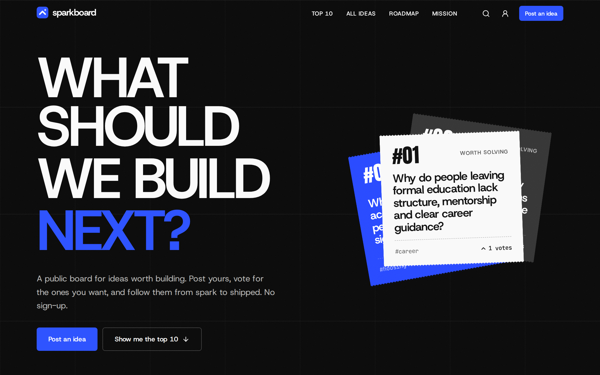
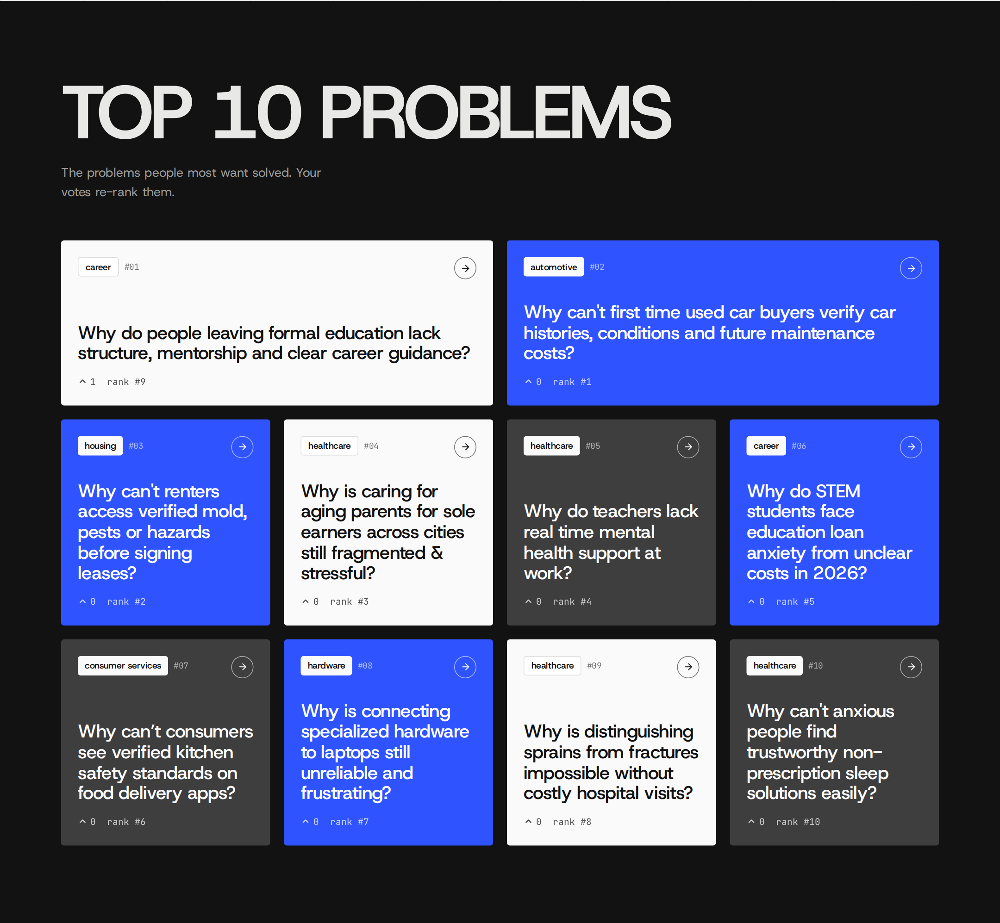
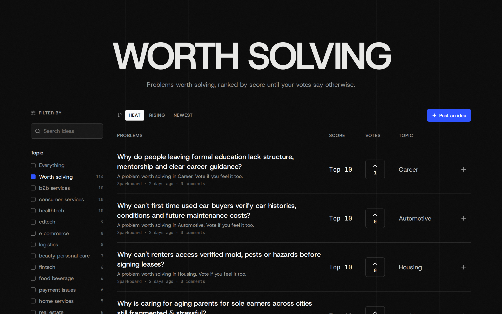
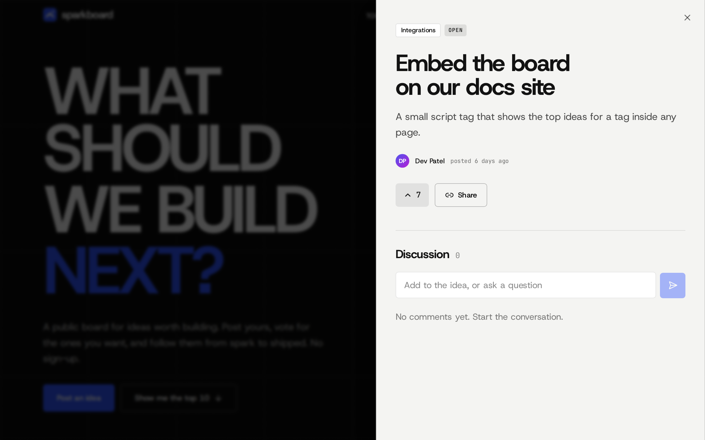
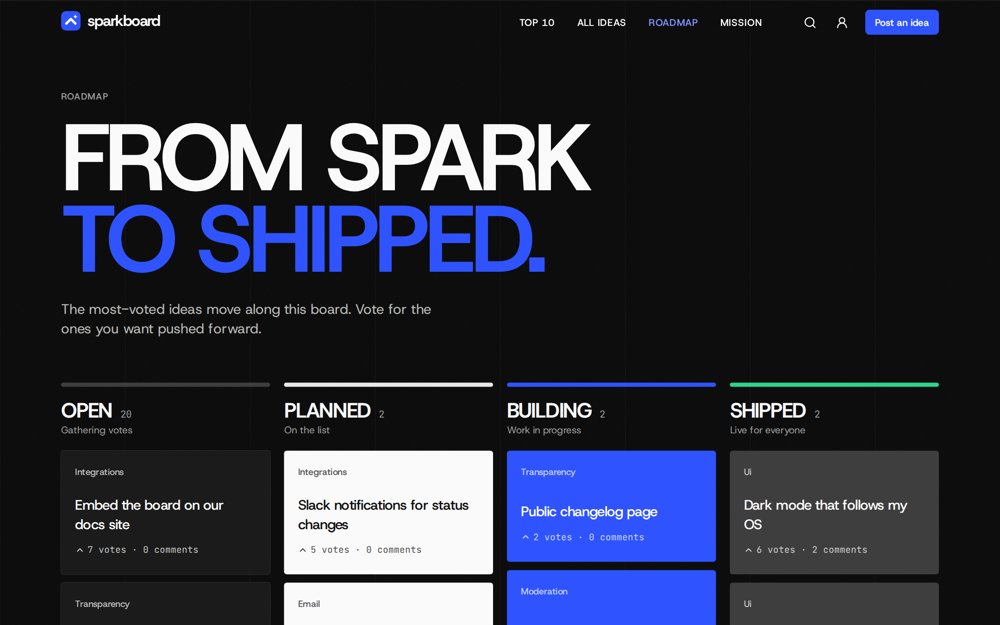
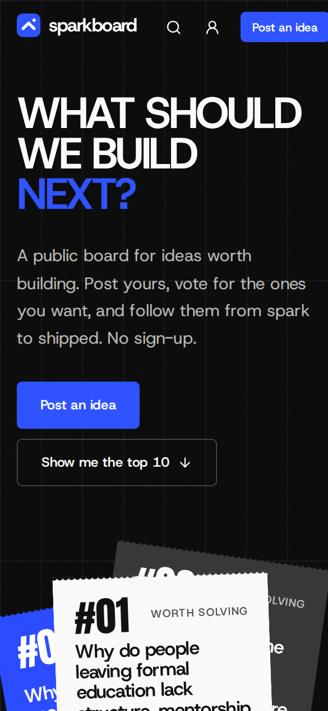
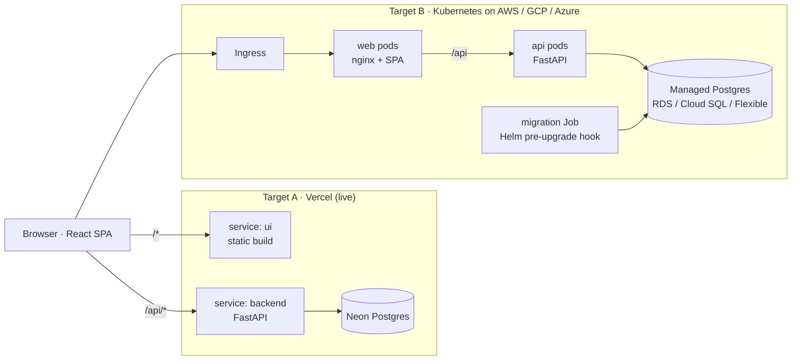

# Sparkboard

**Drop an idea. Fan the best ones. Watch them ship.**
A community idea board by [Infrenic](https://infrenic.com): people post ideas, vote on them, discuss them, and follow them on a public roadmap from *Open* to *Shipped*. It ships through an AI-assisted, cloud-agnostic delivery platform: one codebase, one Helm chart and one set of Terraform modules that target Vercel, AWS, GCP or Azure.

Built by [Manoj Kumar Gogula](https://manojkumargogula.github.io).

| Deployment | Status | URL |
|---|---|---|
| **Vercel + Neon Postgres** | Live | **https://ideas.infrenic.com** · [API docs](https://ideas.infrenic.com/api/docs) |
| AWS (EKS + RDS) | IaC + pipeline ready, validated in CI | not deployed yet |
| GCP (GKE Autopilot + Cloud SQL) | IaC + pipeline ready, validated in CI | not deployed yet |
| Azure (AKS + PostgreSQL Flexible Server) | IaC + pipeline ready, validated in CI | not deployed yet |



## Contents

1. [The product](#the-product)
2. [Architecture](#architecture)
3. [Run it locally with Docker Compose](#run-it-locally-with-docker-compose)
4. [The pipeline: configure and deploy](#the-pipeline-configure-and-deploy)
5. [AI integration](#ai-integration)
6. [Cloud-agnostic approach](#cloud-agnostic-approach)
7. [Quality and security](#quality-and-security)
8. [Repository layout](#repository-layout)
9. [Documentation](#documentation)

---

## The product

Every team and community has more ideas than it can build. Feature requests get lost in chat threads, the same idea is posted five times, and nobody can see what happened to the one they voted for. Sparkboard gives those ideas one public home:

- **Post an idea** in a sentence. While you type, Sparkboard shows similar ideas that already exist, so people vote instead of reposting.
- **Vote** for the ideas you want. Each person gets one vote per idea, and voting needs a Google account, so the ranking reflects real people.
- **Discuss** on each idea's own shareable page.
- **Follow it to shipped** on the public roadmap: Open → Planned → Building → Shipped.

The board opens with 114 curated problems worth solving across 20 industries, ranked by score until the community's votes re-rank them. An optional AI **Sharpen** button rewrites a rough idea into a clear headline and description. Search, the command palette (`⌘K`) and keyboard shortcuts make it fast to get around, and it works just as well on a phone.

The brief's contract is kept exactly: `GET /api/ideas`, `POST /api/ideas` with `{"content": "My new idea"}`, and an `ideas` table with `id, content, created_at`.

| Top 10 problems | Every idea, filterable |
|---|---|
|  |  |

| Idea page with discussion | Public roadmap |
|---|---|
|  |  |

<p align="center"></p>

**Stack:** React 19 + TypeScript + Vite + Tailwind (`app/ui`) · FastAPI + SQLAlchemy 2 async + Alembic (`app/backend`) · PostgreSQL 17. Full feature list: [docs/product.md](docs/product.md).

---

## Architecture



- **One app, two targets.** The same React and FastAPI code runs serverless on Vercel (two services in one project, routed by `vercel.json`) or as containers on any managed Kubernetes. On Kubernetes, nginx serves the SPA and proxies `/api`, so the browser sees one origin.
- **Backend layers:** routers (HTTP) → services (use cases, transactions) → repositories (all SQL) → models. `create_app(settings)` is a factory, so every test gets an isolated app against a real Postgres.
- **Migrations run before traffic shifts** (a Helm pre-upgrade Job on Kubernetes, a pipeline step on Vercel), so they are backward compatible by rule.
- **AI tooling** lives in one typed Python package, `tools/aiops`, used by every workflow.

Request path, data model and deploy sequence diagrams: [docs/architecture.md](docs/architecture.md).

---

## Run it locally with Docker Compose

**Requirements:** Docker with Compose v2. Nothing else.

1. **Clone the repo.**
   ```bash
   git clone https://github.com/manojkumargogula/sparkboard && cd sparkboard
   ```
2. **Optional: configure.** Copy `.env.example` to `.env` to enable AI Sharpen (`AI_PROVIDER=anthropic`, `AI_API_KEY=...`) or Google sign-in. Without it, the app runs with anonymous display names.
3. **Start the stack.**
   ```bash
   docker compose up -d --build --wait
   ```
   This starts `db` (Postgres 17), then `api` (runs `alembic upgrade head`, then serves FastAPI), then `web` (nginx serving the React build and proxying `/api`).
4. **Load demo ideas** (optional).
   ```bash
   docker compose exec api python -m sparkboard_api.seed
   ```
5. **Open http://localhost:8080.** Check the API contract:
   ```bash
   curl -s localhost:8080/api/ideas
   curl -s -X POST localhost:8080/api/ideas -H 'Content-Type: application/json' -d '{"content":"My new idea"}'
   ```
6. **Stop it** with `docker compose down` (add `-v` to delete the database).

`make up` and `make down` do steps 3–4 and 6 in one command. If port 5432 is taken, prefix with `DB_PORT=55432`. Hot-reload development, tests and every `make` target: [docs/development.md](docs/development.md).

---

## The pipeline: configure and deploy

Four GitHub Actions workflows:

| Workflow | Trigger | What it does |
|---|---|---|
| [`ci.yml`](.github/workflows/ci.yml) | every PR and push to `main`, weekly | static analysis, code scanning, tests, end-to-end; AI explains failures |
| [`ai.yml`](.github/workflows/ai.yml) | PRs, PR comments, intent file changes | AI PR review + risk gate, ChatOps `/deploy`, AI environment config |
| [`deploy-vercel.yml`](.github/workflows/deploy-vercel.yml) | after CI passes on `main`, ChatOps, manual | migrate → deploy without moving the domain → probe → AI health gate → promote or block |
| [`deploy-k8s.yml`](.github/workflows/deploy-k8s.yml) | ChatOps, manual | OIDC login → build and push → `terraform apply` (atomic Helm) → probe → AI health gate → auto-rollback |

### Deploy to Vercel (the live target)

1. **Create the project and database.** Apply `infra/terraform/stacks/vercel` (needs `VERCEL_API_TOKEN` and `NEON_API_KEY`), or by hand: `vercel link`, then add Neon Postgres from the Vercel Marketplace.
2. **Set Vercel env vars** (Production and Preview): `DATABASE_URL` (pooled), `DB_SERVERLESS=true`, `ENVIRONMENT`, `ADMIN_TOKEN`, `GOOGLE_CLIENT_ID`, `AUTH_REQUIRED=true`, and optionally `AI_PROVIDER=anthropic` + `AI_API_KEY`.
3. **Set GitHub secrets:** `VERCEL_TOKEN`, `VERCEL_ORG_ID`, `VERCEL_PROJECT_ID`, `DATABASE_URL_UNPOOLED`, `PREVIEW_DATABASE_URL_UNPOOLED`, `NVIDIA_API_KEY` (AI features; `ANTHROPIC_API_KEY` works instead). Set the repository variable `PUBLIC_URL`, and create a GitHub environment `production` with required reviewers (the human approval gate).
4. **Ship.** Merge to `main` (CI runs, then the deploy), or comment `/deploy preview` or `/deploy production` on a PR.

### Deploy to Kubernetes (AWS, GCP or Azure)

1. **Once per cloud:** create a Terraform state bucket and a GitHub OIDC trust for a deploy identity: an IAM role (AWS), Workload Identity Federation (GCP), or a federated app registration (Azure). No long-lived cloud keys are stored.
2. **Set repository variables:** `TF_BACKEND_CONFIG` (e.g. `bucket=my-tf-state`) plus, per cloud, `AWS_DEPLOY_ROLE_ARN` + `AWS_REGION`, or `GCP_WIF_PROVIDER` + `GCP_DEPLOY_SA` + `GCP_PROJECT_ID` + `GCP_REGION`, or `AZURE_CLIENT_ID` + `AZURE_TENANT_ID` + `AZURE_SUBSCRIPTION_ID`.
3. **First apply** creates the network, cluster, database and registry:
   ```bash
   cd infra/terraform/stacks/gcp                     # or aws / azure
   cp example.tfvars terraform.tfvars                # region, size, image_tag (+ project_id on GCP)
   terraform init -backend-config="bucket=my-tf-state"
   terraform apply -var-file=../../environments/generated/production.tfvars
   ```
4. **After that, deploy from GitHub:** run *Deploy · Kubernetes* in the Actions tab, or comment `/deploy on gcp` on a PR. The workflow summary prints the public URL.

Full setup details: [docs/deployment.md](docs/deployment.md).

---

## AI integration

> **Design rule: the model proposes, deterministic code decides.**
> Every AI answer is a typed object, validated against a Pydantic schema. Policy code then checks it and can correct or override it. When the model is unavailable, every feature falls back to rules. AI can make the pipeline smarter, but it can never make it unsafe, and an AI outage never blocks a deploy or a rollback.

All of it lives in [`tools/aiops`](tools/aiops): one small, typed package (mypy strict, 96 % test coverage) with a single LLM adapter, shared by every workflow.

> **Which model.** The pipeline runs on **GLM 5.3 Flash (`z-ai/glm-5.3-flash`) through NVIDIA's OpenAI-compatible API**, using the `NVIDIA_API_KEY` repository secret. The model is asked for JSON matching each schema and the reply is validated; anything invalid falls back to rules. The adapter (`tools/aiops/src/aiops/llm.py`) also supports Claude (`ANTHROPIC_API_KEY`) or any OpenAI-compatible endpoint (`AIOPS_PROVIDER`, `AIOPS_BASE_URL`, `AIOPS_MODEL`), and with no key every feature runs on its deterministic fallback.

### 1. ChatOps deploy planner (AI-assisted command generation)

A PR comment such as `/deploy on gcp`, `/deploy preview` or `/rollback production` is turned by the model into a typed `DeployPlan`: an environment, a target and an ordered list of **allow-listed actions** (`build, test, migrate, deploy, smoke, health_gate, promote, rollback`). The model never writes shell. Policy code then:

- overrides the environment or target if the model misread what the human literally typed;
- keeps environments to what exists: `preview` only on Vercel, and a single `production` environment on AWS, GCP and Azure;
- forces the mandatory sequence (no deploy without smoke and health gate, no promote outside production);
- requires approval for production, enforced by GitHub's `production` environment, not by the model.

The plan is posted on the PR, then the matching deploy workflow executes it with reviewed steps. `/plan <anything>` only explains what would happen. *Value:* natural-language deploys without ever handing an LLM a shell. A test feeds it a model that tries to skip checks and waive approval, and asserts the policy fixes all of it.

### 2. Dynamic environment configuration (generative IaC with guardrails)

There is **one environment, `production`, deployed the same way to AWS, GCP and Azure.** `infra/terraform/environments/production.intent.yaml` describes the need, not the build: *"high-availability production for a public launch, survive a zone outage, $2,500/month, ~120 rps"*. `aiops envgen` asks the model for sizing (size preset, replica ranges, rationale), then:

- clamps it to `policy.yaml` (allowed sizes, replica caps, at least 2 replicas for critical availability);
- steps the size down until a deterministic cost estimate fits the budget **on the most expensive of the three clouds**;
- writes cloud-neutral `generated/production.tfvars` (size) and `production.values.yaml` (replicas), which every cloud's stack and the Helm chart consume. Each cloud keeps only its region in its own `terraform.tfvars`.

`ai.yml` opens the result as a **pull request**, so generated infrastructure is reviewed like any other code. Today's output: `ha` (multi-zone cluster, HA database), API 4–12 and web 2–6 replicas. *Value:* developers state a goal and get a reviewed, budget-checked configuration that is valid on every cloud.

### 3. Intelligent health gate and automatic rollback

After every deploy, `aiops smoke` probes the new release (read-only, error rate, p50/p95) and the previous one for a baseline, and the workflow collects runtime logs. `aiops health` decides:

1. **SLOs first, no AI:** error rate ≤ 1 %, p95 latency ceiling, p95 no more than 1.5× the previous release. Any breach means rollback.
2. **The model reads the metrics and logs** for what thresholds miss: a new exception type, a database pool warning, one slow endpoint. It can only roll back when it is at least 80 % confident.
3. **AI down → the SLOs alone decide.**

On Vercel, production is deployed **without moving the domain** and promoted only if the gate passes, so a bad release never takes user traffic. On Kubernetes the Helm release is atomic, and a failed gate runs `helm rollback`. Either way the pipeline opens an incident issue with the model's plain-English summary and suspected cause. *Value:* fewer bad releases reach users, and the on-call engineer gets a diagnosis instead of a log dump.

### 4. AI PR review with a risk score

Every PR diff gets a structured review (findings per file, risk reasons, suggested tests) and a `risk:low|medium|high` label. **Path rules set a floor the model cannot lower:** migrations and Terraform are always high; workflows, Helm, Docker, `vercel.json`, auth code and dependency changes at least medium. A `risk-gate` check requires two approvals for high-risk PRs. *Value:* reviewers know where to look, and dangerous changes get a second pair of eyes automatically.

### 5. CI failure explainer

When a CI job fails on a PR, the failed log goes to the model, which posts the failing step, the probable cause and a concrete fix as a sticky comment. Without AI it falls back to the first error line.

### 6. In the product

The composer's **Sharpen** button uses the same adapter pattern inside the API (Anthropic or any OpenAI-compatible endpoint). It is rate-limited, treats user text as data, and is hidden when no key is configured.

**Why it is not a gimmick:** no model output is ever executed as a command; every decision passes a schema and a policy that tests prove can override a misbehaving model; every feature degrades to rules; and humans stay in the loop exactly where it matters (production approval, high-risk merges, generated infrastructure). Cheap checks such as duplicate detection stay in plain Postgres. More: [docs/ai-ops.md](docs/ai-ops.md).

---

## Cloud-agnostic approach

The design separates **what** the app needs from **how** each provider sells it, in three layers.

**1. A platform contract.** Each `infra/terraform/modules/platform/<cloud>` builds network + managed Kubernetes + managed Postgres + an image registry, and exposes the **same outputs**: `cluster_name`, `kube_host`, `kube_ca_certificate`, `database_url`, `registry_url`, `ingress_class`, `service_account_annotations`.

| | AWS | GCP | Azure |
|---|---|---|---|
| Kubernetes | EKS (managed node group, IRSA) | GKE Autopilot (private nodes) | AKS (autoscaling pool, workload identity, RBAC) |
| Postgres | RDS 17, Multi-AZ when `ha`, logs to CloudWatch | Cloud SQL 17, private IP, TLS required | Flexible Server 17, VNet-injected |
| Registry | ECR (immutable, scan on push) | Artifact Registry | ACR |
| Ingress | ALB | GCE | App Routing (managed nginx) |

**2. A cloud-neutral app layer.** `modules/app` takes only contract outputs and installs the same Helm chart: a namespace with restricted Pod Security, a Secret kept out of Helm history, and an atomic `helm_release`. It has no provider-specific code.

**3. One word for capacity.** `size = small | medium | ha`, mapped to each cloud's machine and database SKUs by `modules/sizing`. The AI environment generator only speaks this vocabulary.

Switching clouds means picking a different stack and changing a few variables:

```hcl
# stacks/gcp/terraform.tfvars        # stacks/aws/terraform.tfvars
project_id = "my-project"            region    = "eu-central-1"
region     = "europe-west3"          size      = "small"
size       = "small"                 image_tag = "3f2c1ab"
image_tag  = "3f2c1ab"
```

**The pipeline is cloud-agnostic too.** `deploy-k8s.yml` has exactly one per-cloud branch, the OIDC login. Build, apply, probe, health gate and rollback are shared, and Vercel sits behind the same probe → gate → promote/rollback flow.

**Adding a fourth cloud** (say DigitalOcean): write `modules/platform/digitalocean` (DOKS + Managed Postgres + DOCR) emitting the same outputs, add a ~70-line `stacks/digitalocean` root and a `values/digitalocean.yaml`, and add one login step to `deploy-k8s.yml`. The app module, chart, images, AI tooling and health gate stay unchanged.

---

## Quality and security

- **Code scanning on every PR:** Semgrep (SAST) and Trivy (dependencies, IaC, secrets) report to GitHub code scanning; gitleaks over the full history; Trivy scans both container images; bandit, pip-audit, npm audit.
- **Static analysis:** ruff + mypy strict, eslint strict type-checked + jsx-a11y, tsc, hadolint, actionlint, terraform validate + tflint, helm lint + kubeconform for every cloud.
- **Tests:** API 39 tests against real Postgres (92 % coverage), UI 33, aiops 96 % coverage, Playwright end-to-end on desktop and mobile.
- **Runtime:** non-root containers with a read-only filesystem and no capabilities, restricted Pod Security, a NetworkPolicy, Google ID-token verification, rate limits, CSP and security headers.
- **Supply chain:** every action pinned to a commit SHA, per-job least-privilege permissions, explicit secrets per reusable workflow, Dependabot with a 7-day cooldown, OIDC instead of cloud keys.

Details: [docs/ci.md](docs/ci.md) · [docs/code-quality.md](docs/code-quality.md).

---

## Repository layout

```
app/
  backend/            FastAPI service (routers → services → repositories → models), Alembic migrations
  ui/                 React SPA (features/, ui/, lib/), Playwright tests
tools/aiops/          AI delivery toolkit: plan · review · envgen · smoke · health · explain
infra/
  docker/             Dockerfiles + nginx.conf
  helm/sparkboard/    one Kubernetes chart, values/<cloud>.yaml per cloud
  terraform/          modules/ (sizing · platform/{aws,gcp,azure} · app · vercel) · stacks/<target> · environments/ (one: production)
.github/workflows/    ci · ai · deploy-vercel · deploy-k8s
docs/                 detailed documentation

vercel.json           Vercel config: ui + backend services
docker-compose.yml    local stack
Makefile              command entry point (make help)
```

## Documentation

AI coding agents: start with [AGENTS.md](AGENTS.md).

| Doc | What's in it |
|---|---|
| [Product](docs/product.md) | features and tech stack |
| [Architecture](docs/architecture.md) | request path, API layers, data model, deploy sequences, security, trade-offs |
| [Development](docs/development.md) | hot reload, make targets, tests, migrations |
| [CI and code scanning](docs/ci.md) | every check, and how to handle a finding |
| [Code quality](docs/code-quality.md) | standards, naming, branch and commit conventions |
| [Deployment](docs/deployment.md) | full Vercel and Kubernetes setup |
| [AI operations](docs/ai-ops.md) | every AI feature in depth |

## Author

Built by **Manoj Kumar Gogula**: design, frontend, backend, infrastructure and CI/CD.
Portfolio and other projects: **https://manojkumargogula.github.io**

## License

MIT © Infrenic
