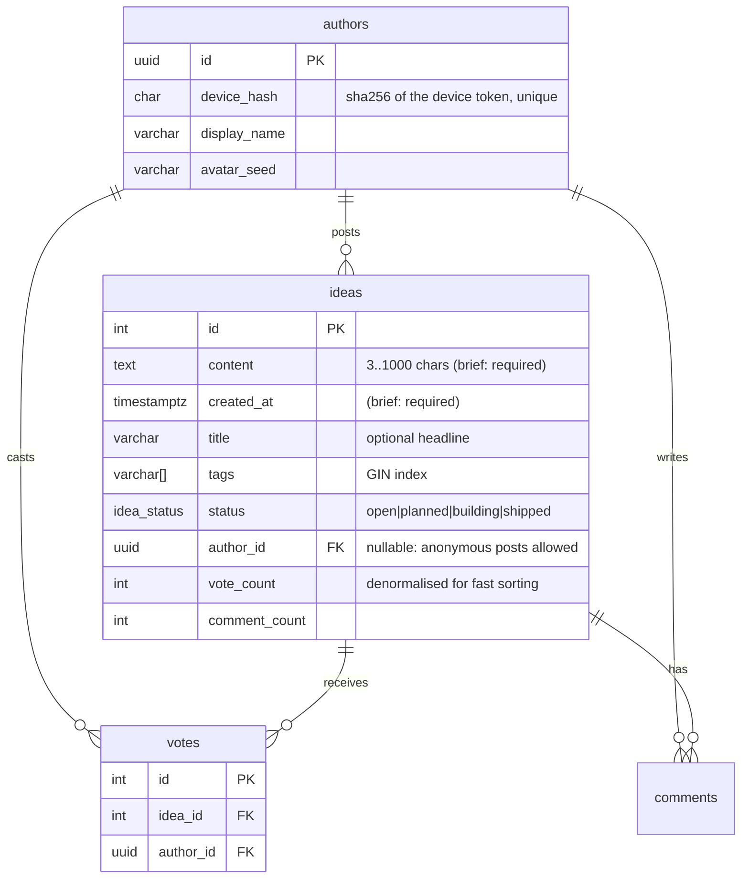
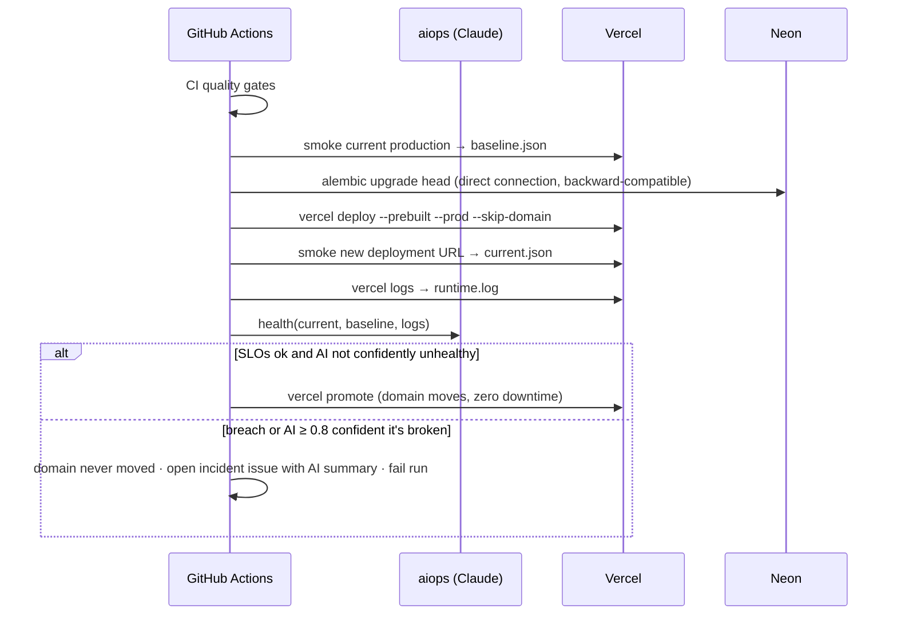
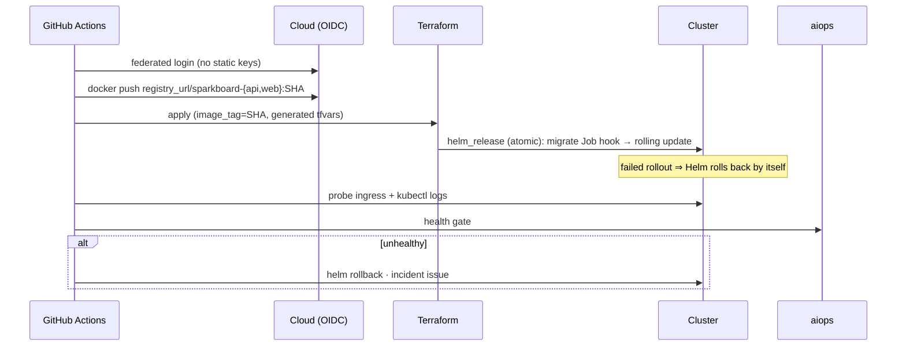

# Architecture

## Request path

```mermaid
sequenceDiagram
  participant U as Browser
  participant E as Edge (Vercel CDN / Ingress + nginx)
  participant A as API (FastAPI)
  participant D as Postgres

  U->>E: GET /            (SPA, cached assets)
  U->>E: GET /api/ideas?sort=trending  (X-Device-Token)
  E->>A: proxied / rewritten
  A->>D: SELECT ideas + "voted by me" (EXISTS subquery)
  D-->>A: rows
  A-->>U: JSON array (X-Next-Offset when another page exists)
  U->>E: PUT /api/ideas/7/vote (optimistic UI already updated)
  A->>D: INSERT vote ON CONFLICT DO NOTHING; UPDATE vote_count
  A-->>U: {vote_count, voted}
```

## API layering

Each layer has one job, and dependencies only point downward.

```
api/routers/*     HTTP shape: params, status codes, dependencies (rate limits, identity, admin)
services/*        use-cases and transactions; raise domain errors (NotFoundError)
repositories/*    every SQL statement lives here
models.py         SQLAlchemy tables      schemas.py   Pydantic contracts (validation at the edge)
ai/*              LLMProvider protocol → anthropic | openai-compatible | null
core/*            config, db engine, logging, rate limiter, device-token hashing
```

`create_app(settings)` is a factory, so tests build an isolated app per test against a real Postgres. Nothing reads global state.

## Data model



There is a unique constraint on `votes(idea_id, author_id)`. The `pg_trgm` GIN index on `ideas.content` powers search and duplicate detection.

## Deploy sequence (production, Vercel)



## Deploy sequence (Kubernetes, any cloud)


