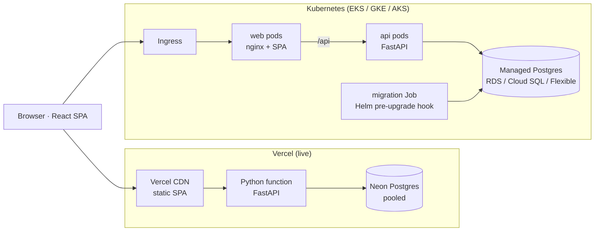
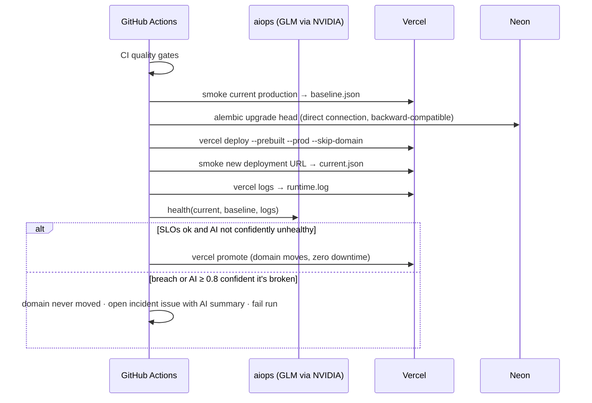
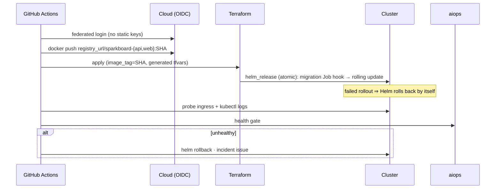

# Architecture

## System



The same API and web code runs on both targets. On Vercel, `vercel.json` defines two services, `ui` (`app/ui`) and `backend` (`app/backend`), and routes `/api/*` to the backend. On Kubernetes, nginx serves the SPA and proxies `/api` to the API pods.

## Request path

```mermaid
sequenceDiagram
  participant U as Browser
  participant E as Edge (Vercel CDN / Ingress + nginx)
  participant A as API (FastAPI)
  participant D as Postgres

  U->>E: GET /            (SPA, cached assets)
  U->>E: GET /api/ideas?sort=trending  (X-Device-Token)
  E->>A: proxied / rewritten
  A->>D: SELECT ideas + "voted by me" (EXISTS subquery)
  D-->>A: rows
  A-->>U: JSON array (X-Next-Offset when another page exists)
  U->>E: PUT /api/ideas/7/vote (optimistic UI already updated)
  A->>D: INSERT vote ON CONFLICT DO NOTHING; UPDATE vote_count
  A-->>U: {vote_count, voted}
```

## API layering

Each layer has one job, and dependencies only point downward.

```
api/routers/*     HTTP shape: params, status codes, dependencies (rate limits, identity, admin)
services/*        use-cases and transactions; raise domain errors (NotFoundError)
repositories/*    every SQL statement lives here
models.py         SQLAlchemy tables      schemas.py   Pydantic contracts (validation at the edge)
ai/*              LLMProvider protocol → anthropic | openai-compatible | null
core/*            config, db engine, logging, rate limiter, device tokens, Google token check
importers/*       idempotent data loaders (curated problems)
```

`create_app(settings)` is a factory, so tests build an isolated app per test against a real Postgres. Nothing reads global state.

## Data model

```mermaid
erDiagram
  authors ||--o{ ideas : posts
  authors ||--o{ votes : casts
  authors ||--o{ comments : writes
  authors ||--o{ author_devices : "signs in from"
  ideas ||--o{ votes : receives
  ideas ||--o{ comments : has

  ideas {
    int id PK
    text content "3..1000 chars (brief: required)"
    timestamptz created_at "(brief: required)"
    varchar title "optional headline"
    varchar[] tags "GIN index"
    idea_status status "open|planned|building|shipped"
    uuid author_id FK "nullable: anonymous posts allowed"
    int vote_count "denormalised for fast sorting"
    int comment_count
    varchar source "curated set: source, rank, score"
  }
  votes {
    int id PK
    int idea_id FK
    uuid author_id FK
  }
  authors {
    uuid id PK
    char device_hash "sha256 of a device token (anonymous use)"
    varchar google_sub "unique Google account id"
    varchar display_name
    varchar picture_url
  }
  author_devices {
    char device_hash PK "every device a Google account signed in from"
    uuid author_id FK
  }
```



There is a unique constraint on `votes(idea_id, author_id)`. The `pg_trgm` GIN index on `ideas.content` powers search and duplicate detection.

## Deploy sequence (production, Vercel)



## Deploy sequence (Kubernetes, any cloud)



## Security

- **Least privilege at runtime.** Containers run non-root with a read-only root filesystem, drop all capabilities and use the RuntimeDefault seccomp profile. Namespaces enforce the restricted Pod Security standard. A NetworkPolicy lets only the web tier reach the API.
- **Identity.** Google ID tokens are verified against Google's published keys (signature, audience, issuer, expiry, verified email). Device tokens are stored only as SHA-256 hashes. The admin token is compared in constant time.
- **Abuse limits.** Per-device and per-IP rate limits on writes and AI calls, strict input validation, and fully parameterised SQL through SQLAlchemy.
- **Secrets.** Never in the repo or in Helm history. The Kubernetes Terraform uses workload identity, so pods hold no static cloud keys.
- **Code scanning.** Every PR runs Semgrep, Trivy (dependencies, IaC, secrets, images), gitleaks, bandit, pip-audit and npm audit (see [ci.md](ci.md)).
- **Pipeline.** Least-privilege `permissions:` per job, every action pinned to a commit SHA, secrets scoped to the job that uses them, and a 7-day Dependabot cooldown. LLM inputs are fenced as untrusted data, and model output is never executed.
- **Headers.** CSP, `X-Frame-Options: DENY`, nosniff, a strict referrer policy and a permissions policy, set by nginx (`infra/docker/nginx.conf`) and Vercel (`vercel.json`).

## Trade-offs and next steps

- **Rate limiting is per instance** (in-process). Fine for one replica or serverless instance; at scale it moves to the edge (Vercel Firewall / ingress) or Redis.
- **Polling, not websockets**, for "new ideas". Simpler and works on serverless; SSE would be next.
- **The Kubernetes targets are not applied.** Three managed clusters cost real money each month. The chart is linted and schema-checked for each cloud, and the Terraform is validated and scanned in CI.
- **Next:** a "follow an idea" email digest, moderation tools (merge duplicates), and OpenTelemetry traces feeding the health gate.
